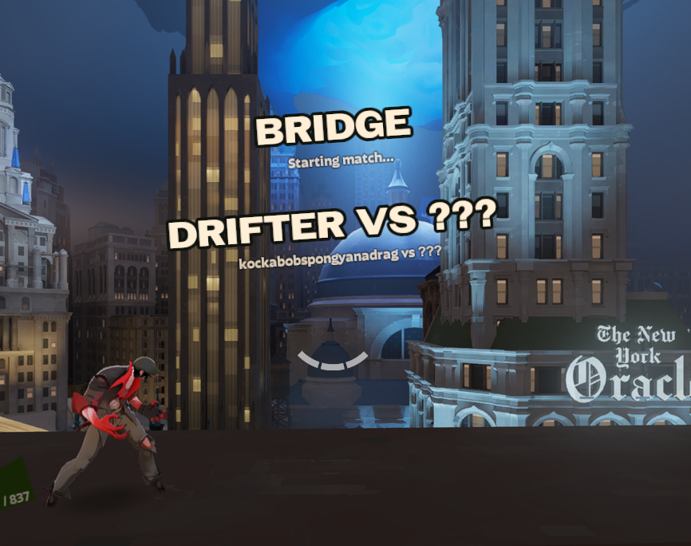
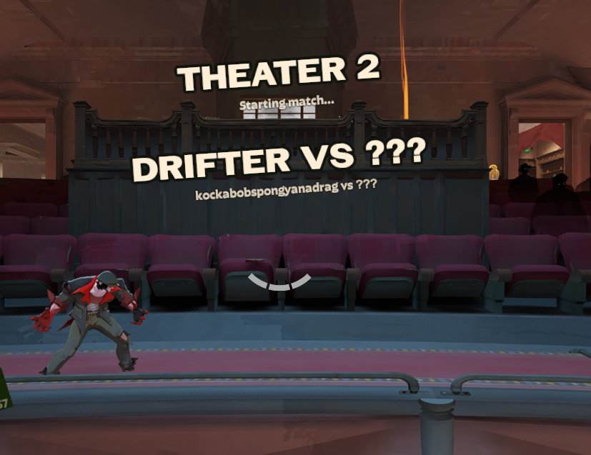
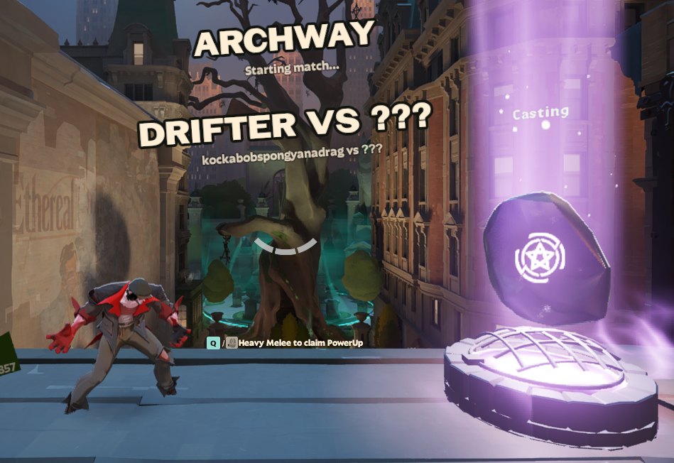

# Bare Knuckle

A server-side plugin for **Deadlock** using **Deadworks** that adds a new 2d fighter like gamemode.
Featuring **12** arenas all around New York.




*A small selection of the arenas.*

## Controls

**A / D** - Left / Right Move
**W / S** - Up / Down Look
**M1 / Melee** - Attack

## Development

### Running
```sh
D:\SteamLibrary\steamapps\common\Deadlock\game\bin\win64\deadworks.exe

connect localhost:27067
```

### Updating
```sh
git pull

dotnet restore deadworks.slnx

"C:\Program Files\Microsoft Visual Studio\18\Community\MSBuild\Current\Bin\amd64\MSBuild.exe" deadworks\deadworks.vcxproj /p:Configuration=Release /p:Platform=x64 /m /verbosity:minimal

dotnet build managed\DeadworksManaged.csproj -c Release -o managed\bin\Release\
```